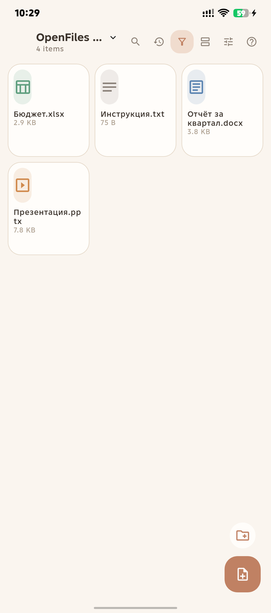
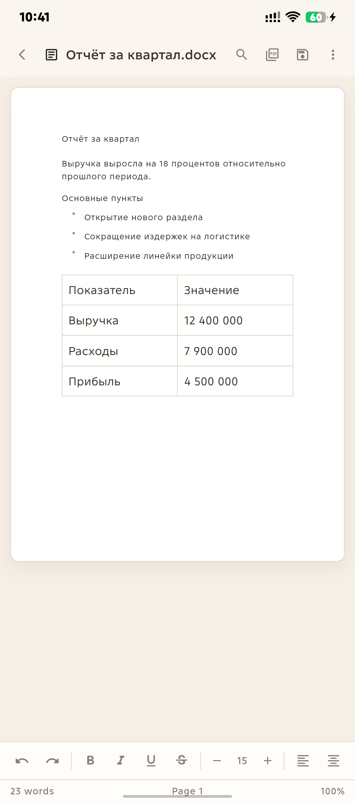
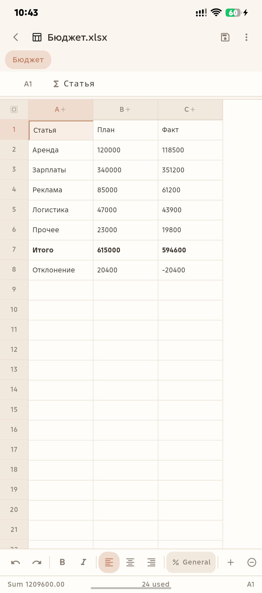
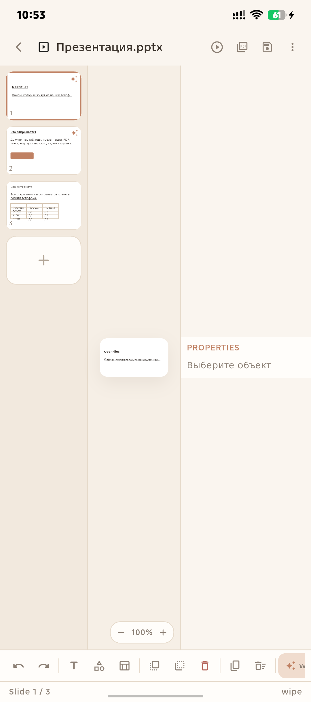
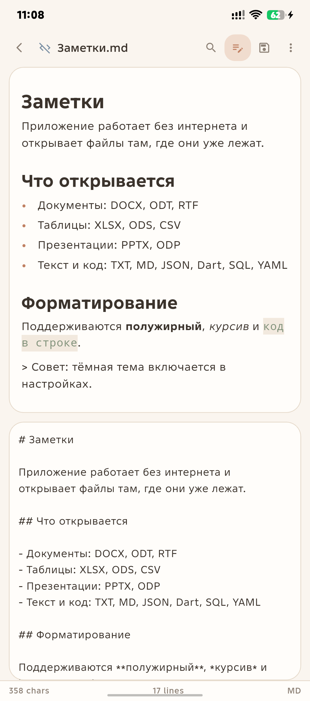
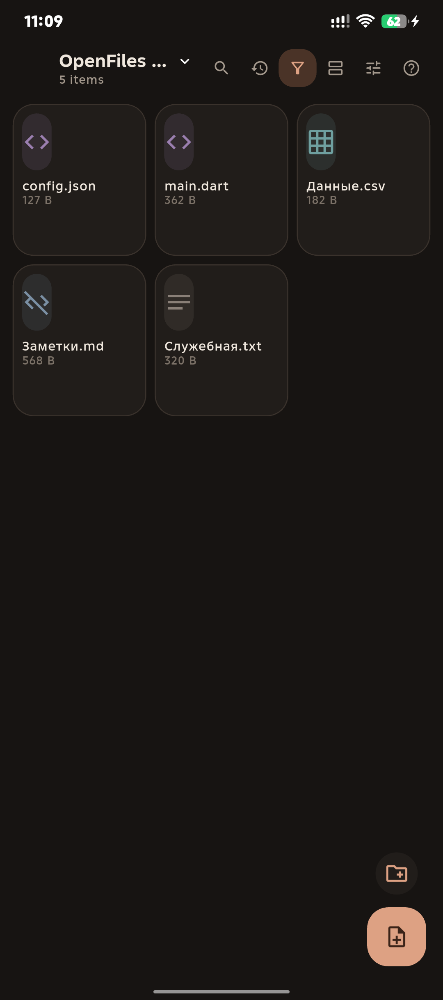
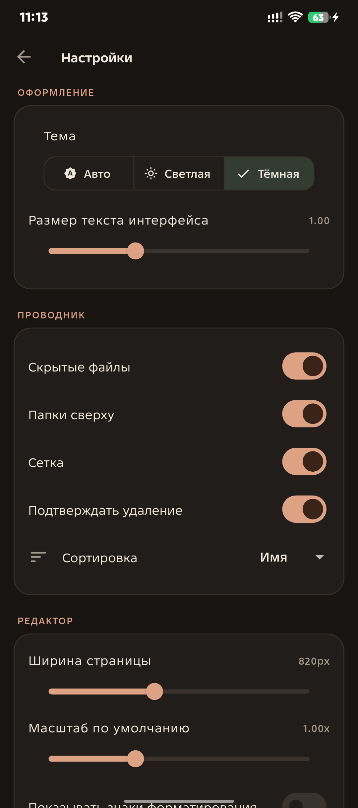
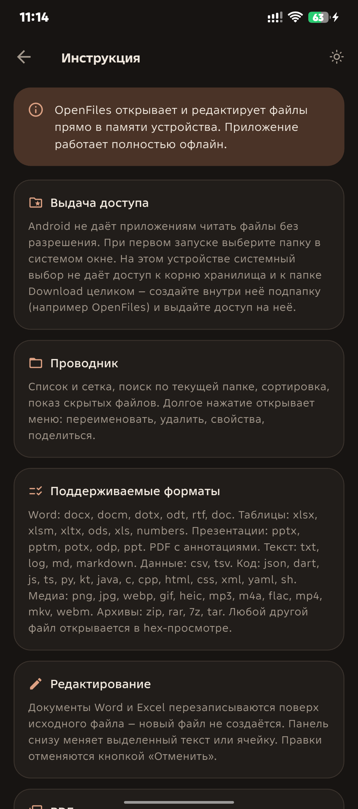

# OpenFiles

Файловый менеджер и редактор для Android, который открывает и правит файлы **прямо в памяти устройства**. Никаких копий в приватном хранилище: всё читается и записывается в выданную вами папку.

Приложение полностью работает офлайн. Без рекламы, без телеметрии, без аккаунтов.

<p align="center">
  
  
  
</p>
<p align="center">
  
  
  
</p>

---

## Установка

Скачайте APK из [последнего релиза](https://github.com/miiko3/OpenFiles/releases/latest) и разрешите установку из неизвестных источников.

| Файл | Для чего |
|---|---|
| `OpenFiles-<версия>-arm64-v8a.apk` | современные телефоны, **большинство устройств** |
| `OpenFiles-<версия>-armeabi-v7a.apk` | старые 32-разрядные устройства |
| `OpenFiles-<версия>-x86_64.apk` | эмуляторы и планшеты на Intel/AMD |

Требуется Android 7.0 (API 24) или новее.

---

## Что умеет

**Открывает любые файлы** — от Word и Excel до шрифтов и архивов. Неизвестный формат не приводит к ошибке: он открывается в hex-просмотре с поиском по байтам.

**Редактирует документы** — `.docx`, `.xlsx`, `.pptx` читаются и записываются собственными кодеками OOXML. Файл перезаписывается на месте, новый документ не создаётся.

**Аннотирует PDF** — выделение, подчёркивание, зачёркивание, заметки и рисование поверх страницы.

**Играет медиа** — видео и аудио с плеером, просмотр изображений с зумом, разбор архивов с предпросмотром содержимого.

<p align="center">
  
  
</p>

---

## Попробовать без своих файлов

В репозитории лежит набор демонстрационных файлов — папка `docs/demo/` собрана **теми же кодеками**, которыми пользуется приложение, поэтому каждый файл заведомо открывается корректно:

```
docs/demo/
├── Документы/
│   ├── Отчёт за квартал.docx   заголовок, абзацы, список, таблица
│   ├── Бюджет.xlsx             формулы SUM, жирные строки, числа
│   ├── Презентация.pptx        текст, фигуры, таблица, переходы
│   └── Инструкция.txt
├── Текст и код/
│   ├── Заметки.md              Markdown с заголовками и списками
│   ├── Данные.csv
│   ├── config.json
│   ├── main.dart
│   └── Служебная.txt
├── Изображения/
│   └── Обложка.png
└── Архивы/
    └── Резервная копия.zip
```

Скопируйте папку на телефон и выдайте приложению к ней доступ — всё содержимое откроется и отредактируется.

---

## Поддерживаемые форматы

| Категория | Форматы |
|---|---|
| Текстовые документы | `docx` `docm` `dotx` `odt` `rtf` `doc` |
| Таблицы | `xlsx` `xlsm` `xltx` `ods` `xls` `numbers` |
| Презентации | `pptx` `pptm` `potx` `odp` `ppt` |
| PDF | `pdf` |
| Текст | `txt` `log` `md` `markdown` `mdx` |
| Данные | `csv` `tsv` |
| Код | `json` `dart` `js` `jsx` `ts` `tsx` `py` `rb` `go` `rs` `java` `kt` `c` `h` `cpp` `cs` `swift` `php` `sh` `bash` `ps1` `bat` `sql` `html` `css` `scss` `xml` `yaml` `toml` `ini` `gradle` `cmake` `lua` `vue` `svelte` |
| Изображения | `png` `jpg` `jpeg` `gif` `webp` `bmp` `heic` `heif` `ico` `tif` `svg` `avif` |
| Аудио | `mp3` `m4a` `aac` `ogg` `oga` `opus` `flac` `wav` `wma` `amr` `mid` `midi` |
| Видео | `mp4` `mkv` `webm` `mov` `avi` `wmv` `flv` `3gp` `m4v` |
| Архивы | `zip` `rar` `7z` `tar` `gz` `bz2` `xz` `zst` `apk` `iso` `jar` |
| Электронные книги | `epub` `mobi` `azw` `azw3` `fb2` |
| Шрифты | `ttf` `otf` `woff` `woff2` |

---

## Выдача доступа к файлам

Android не позволяет приложениям читать файлы без явного разрешения. При первом запуске OpenFiles открывает системный выбор папки.

**Важно для Android 11 и новее.** Системное окно не даёт выдать доступ на корень хранилища и на папку `Download` целиком — она считается слишком широкой. Нужно зайти внутрь неё и создать подпапку:

1. Откройте системный выбор папки.
2. Перейдите в `Download`.
3. Нажмите «Новая папка» и создайте, например, `OpenFiles`.
4. Войдите в неё и подтвердите «Использовать эту папку».
5. Разрешите доступ в системном диалоге.

После этого папка сохраняется в приложении, и к ней можно вернуться в любой момент.

Открыть файл из другого приложения тоже можно: установите OpenFiles приложением по умолчанию для нужных типов файлов или используйте «Отправить в» в контекстном меню.

---

## Интерфейс

**Проводник.** Список и сетка, поиск по текущей папке, четыре варианта сортировки, показ скрытых файлов, переключатель «только поддерживаемые». Долгое нажатие открывает меню: переименовать, удалить, свойства, поделиться. Кнопки создания файла и папки — в правом нижнем углу.

**Документы.** Панель снизу меняет выделенный текст: полужирный, курсив, подчёркивание, зачёркивание, размер, цвет, четыре варианта выравнивания, маркированные и нумерованные списки, шесть уровней заголовков, таблицы, линии и разрывы страниц. Есть поиск с заменой, подсчёт слов, настройка полей и ориентации страницы, экспорт в PDF, отмена и повтор действий.

**Таблицы.** Сетка с закреплёнными заголовками строк и столбцов, строка формул, навигация стрелками и Tab. Работают формулы: `SUM` `AVERAGE` `MIN` `MAX` `COUNT` `IF` `IFS` `SUMIF` `COUNTIF` `VLOOKUP` `INDEX` `MATCH` `ROUND` `CONCATENATE` `LEFT` `RIGHT` `LEN` `TODAY` и многие другие. Форматирование ячеек, восемь числовых форматов, вставка и удаление строк и столбцов, сортировка, закрепление областей, копирование и вставка, экспорт в CSV и PDF.

**Презентации.** Миниатюры слайдов слева, холст в центре, свойства объекта справа. Фигуры, надписи, таблицы, изменение размера, поворота, цвета и шрифта. Переходы между слайдами, заметки докладчика, экспорт в PDF и полноэкранный показ с таймером и предпросмотром следующего слайда.

**PDF.** Масштабирование, перелистывание, семь инструментов аннотаций и выбор цвета метки.

**Настройки.** Тема, размер текста интерфейса, показ скрытых файлов, порядок сортировки, ширина страницы, масштаб, автосохранение, язык интерфейса и список папок доступа.

**Инструкция** доступна прямо в приложении: кнопка со знаком вопроса в правом верхнем углу проводника.

---

## Оформление

Скруглённые формы повсюду, тёплая приглушённая палитра. Светлая и тёмная темы используют одни и те же оттенки — терракота, шалфей, бронза и тёплый крем. Переключение темы: настройки или кнопка в шапке экрана инструкции.

---

## Технологии

Flutter и Dart. Форматы Office разбираются и собираются вручную поверх `archive` и `xml`, без готовых офисных библиотек, поэтому поведение полностью предсказуемо и не зависит от чужих лицензий.

Доступ к файлам реализован через Storage Access Framework: нативный мост на Kotlin поверх `DocumentsContract`. Форматы сопоставляются по расширению, MIME-типы не требуются.

---

## Сборка

Нужен Flutter SDK и Android SDK.

```bash
flutter pub get
flutter analyze
flutter test
flutter build apk --release --split-per-abi
```

Готовые APK появятся в `build/app/outputs/flutter-apk/`. Установка на устройство:

```bash
adb install -r build/app/outputs/flutter-apk/app-arm64-v8a-release.apk
```

Сборка подписывается ключом из `android/key.properties`. Если файла нет, используется отладочная подпись — она годится только для личной установки.

Серверные сборки выполняются в GitHub Actions: каждый push в `main` и каждый тег `v*` собирает APK и публикует релиз.

Пересобрать демонстрационные файлы из `docs/demo/`:

```bash
flutter test test/make_demo_test.dart
```

---

## Автор

Проект открытый. Код, замечания и предложения — в репозитории miiko3.

- GitHub — <https://github.com/miiko3?tab=repositories>
- Telegram — <https://t.me/yetilov>
- Boosty — <https://boosty.to/miilo3>
- YooMoney — <https://yoomoney.ru/fundraise/1GJCNQ28KCK.260319>

Приложение бесплатное и без рекламы. Если оно оказалось полезным, поддержать разработку можно по ссылкам выше.

---

## Лицензия

MIT.